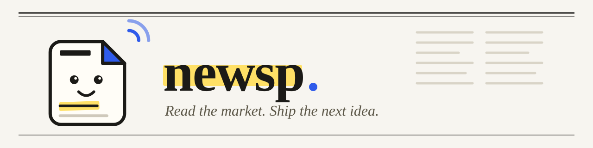

<p align="center">
  <picture>
    <source media="(prefers-color-scheme: dark)" srcset="docs/assets/banner-dark.svg">
    <source media="(prefers-color-scheme: light)" srcset="docs/assets/banner.svg">
    
  </picture>
</p>

<p align="center">
  <a href="https://github.com/dev-fritz/newsp/actions/workflows/ci.yml"></a>
  <a href="https://github.com/dev-fritz/newsp/actions/workflows/codeql.yml"></a>
  <a href="https://dev-fritz.github.io/newsp/"></a>
  <a href="LICENSE"></a>
  
  
</p>

<p align="center">
  <a href="https://dev-fritz.github.io/newsp/">Documentação</a> ·
  <a href="https://dev-fritz.github.io/newsp/installation/">Instalação</a> ·
  <a href="https://dev-fritz.github.io/newsp/configuration/">Configuração</a> ·
  <a href="https://dev-fritz.github.io/newsp/how-it-works/">Como funciona</a> ·
  <a href="https://dev-fritz.github.io/newsp/faq/">FAQ</a> ·
  <a href="CONTRIBUTING.md">Contribuir</a> ·
  <a href="README.md">English</a>
</p>

**newsp** é um radar de mercado autohospedado e multiusuário. Ele coleta notícias e discussões
do Hacker News, TabNews, Reddit, YouTube, Lobsters, dev.to, Mastodon, Bluesky, GitHub, Product
Hunt e de qualquer feed RSS e usa modelos de IA (locais ou
hospedados) para escrever um **relatório diário do mercado** para cada usuário e **ideias de
projetos de software que não se repetem**: quando uma ideia nova é parecida demais com uma que
você já tem, ela vira uma nova versão dessa ideia, e não uma duplicata.

## Funcionalidades

- **Coleta** agendada por fonte (Hacker News, TabNews, Reddit, canais do YouTube, Lobsters,
  dev.to, Mastodon, Bluesky, repositórios novos do GitHub, lançamentos do Product Hunt, RSS), com busca
  em texto completo sobre tudo o que foi coletado.
- **Relatório diário** por usuário, ordenado pelos seus interesses, com citações numeradas para
  os itens originais e uma seção "o que mudou desde o último relatório". Gere um sob demanda
  para qualquer janela.
- **Ideias de projeto** que explicam por que agora, para quem e como: público, stack e
  arquitetura, plano de MVP, monetização, concorrentes e as evidências por trás.
- **Sem duplicatas**: embeddings e um LLM juiz mesclam ideias quase iguais numa nova versão, com
  histórico, diff por palavra, "aprofundar com IA" e edição manual.
- **Qualquer modelo**: Ollama, llama.cpp, LM Studio ou qualquer servidor compatível com OpenAI,
  além de OpenAI, Anthropic e Gemini. Escolha o modelo por tarefa; as chaves de API ficam
  criptografadas no banco.
- **Multiusuário**: o admin convida pessoas por link ou e-mail, com cadastro público opcional e
  verificação de e-mail (e-mail via SMTP é opcional); cada usuário tem os próprios interesses,
  horário, idioma (português ou inglês) e tema.

## Começo rápido

Requisitos: Docker com Compose e `openssl`.

```bash
git clone https://github.com/dev-fritz/newsp.git
cd newsp
./scripts/init-env.sh          # cria o .env com segredos aleatórios
docker compose up -d --build
```

Abra <http://localhost:3000>, crie a conta de admin e siga a configuração: adicione um provedor
de IA e seus modelos e depois algumas fontes. O primeiro relatório e as primeiras ideias aparecem
depois da primeira coleta.

Modelos locais: `docker compose --profile ollama up -d` sobe o Ollama junto da stack; adicione um
provedor "compatível com OpenAI" com a URL `http://ollama:11434/v1`. Para servir o newsp num
domínio, coloque-o atrás de um proxy reverso com TLS; veja o
[guia de instalação](https://dev-fritz.github.io/newsp/installation/) (em inglês).

## Desenvolvimento

```bash
cd api && cp .env.example .env && make infra-up migrate
make run                       # API em :8080 (em outro terminal: make worker)
cd ../web && cp .env.example .env && pnpm install
pnpm dev                       # http://localhost:5173
```

Antes de abrir uma PR: `cd api && make check` e
`cd web && pnpm lint && pnpm typecheck && pnpm format:check && pnpm build`.
Veja o [CONTRIBUTING.md](CONTRIBUTING.md) e o [guia de desenvolvimento](https://dev-fritz.github.io/newsp/development/).

## Como é feito

| Parte | Stack |
| --- | --- |
| `api/` | Go: API HTTP e um worker que roda os jobs de coleta e geração a partir de uma fila no Postgres |
| `web/` | React Router (SSR) com um backend-for-frontend que mantém os tokens fora do navegador, Tailwind e shadcn/ui |
| Dados | PostgreSQL 17 com pgvector |
| `docs/` | A documentação, publicada com MkDocs Material |

Mais em [Como funciona](https://dev-fritz.github.io/newsp/how-it-works/) e
[Arquitetura](https://dev-fritz.github.io/newsp/architecture/).

## Contribuição e segurança

Issues e pull requests são bem-vindos; leia o [CONTRIBUTING.md](CONTRIBUTING.md) e o
[Código de Conduta](CODE_OF_CONDUCT.md). Relate vulnerabilidades em particular, como descrito no
[SECURITY.md](SECURITY.md).

## Licença

[GNU AGPL-3.0](LICENSE). Se você roda um newsp modificado para outras pessoas pela rede, precisa
oferecer a elas o código-fonte.
