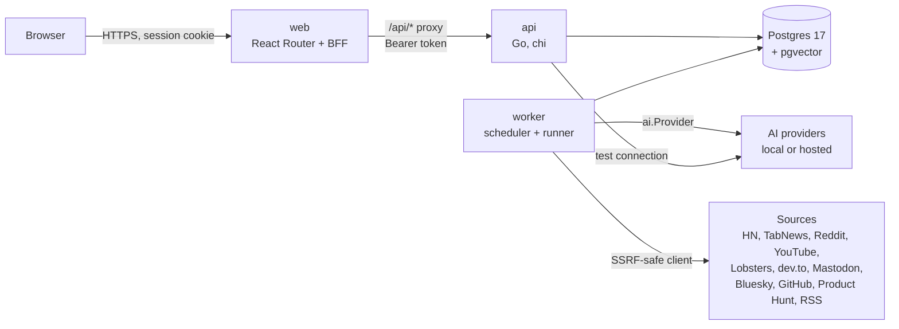

# Architecture

## Components

| Part | Responsibility |
| --- | --- |
| `web` | Server-rendered React Router 8 app. Owns the user session and proxies `/api/*` to the API. Tailwind and shadcn/ui, pt-BR and English |
| `api` | HTTP API under `/api/v1` (chi). Auth, admin, CRUD, enqueues jobs, never runs migrations on start |
| `worker` | Same codebase, `cmd/worker`: a scheduler that enqueues periodic work and a runner that executes jobs (4 in parallel) |
| `migrate` | `cmd/migrate`: applies SQL migrations (golang-migrate) |
| Postgres | System of record, vector search (pgvector, HNSW cosine) and the job queue |
| AI layer | `api/pkg/ai`: a hand-written `Provider` interface (chat, embeddings, model list) for OpenAI-compatible servers, OpenAI, Anthropic and Gemini. Services reach it through `AIGateway`, never through a vendor API |

The backend is layered: handlers (HTTP only), services (business rules), repositories
(hand-written SQL, no ORM), models and DTOs. The OpenAPI contract is generated with swag and the
web app's types are generated from it.

## Data model overview

- **Accounts:** `users` (role admin or member, locale, time zone, status), `user_tokens` (invite,
  admin password reset, self-service reset (1 hour) and `email_verification` (24 hours), stored as SHA-256 hashes, expiring, single use), `refresh_tokens` (hashed,
  rotating, with family tracking and revocation).
- **Collection:** `sources` (kind, config as JSON, interval, next run, last error) one-to-many
  `items` (unique `external_id` per source, URL, title, summary, author, date, metrics, extracted
  text, `embedding vector(768)`, embedding model).
- **AI:** `ai_providers` (kind, base URL, encrypted key) one-to-many `ai_models` (chat or
  embedding), `instance_settings` (embedding model, defaults, retention, dedup threshold) and
  `ai_usage` (tokens per user, model and purpose).
- **Profile:** `user_preferences`, one per user.
- **Reports:** `reports` (user, window, kind, status, Markdown, summary) linked to the items they
  cite through `report_items`.
- **Ideas:** `ideas` (user, status, title, embedding, current version) one-to-many `idea_versions`
  (origin generated, merged, deepened or manual; sections; change note; model; similarity),
  linked to items through `idea_evidence`.
- **Jobs:** `jobs` (kind, payload, status, run time, attempts, last error, dedupe key, lock owner).

## Job queue and worker

Jobs live in Postgres and are claimed with `FOR UPDATE SKIP LOCKED`, so several workers can run
safely. Job kinds: collect a source, embed pending items, generate a report, generate ideas,
deepen an idea, send an e-mail, send a password reset, retention and embedding reindex.

- **Scheduler** (a tick every 15 seconds) enqueues due work: sources every 30 seconds, scheduled
  reports every minute, retention every 6 hours, plus housekeeping.
- **Dedupe keys** keep at most one active job per key, so clicking twice does not run twice.
- **Retries** use exponential backoff from 30 seconds up to one hour with jitter, up to 5 attempts
  by default. Permanent errors fail immediately.
- **Stale jobs** locked by a dead worker are requeued by a reaper every minute.
- **Timeouts** per kind: 3 minutes to collect, 10 to embed, 20 to write a report or deepen an idea,
  30 to generate ideas. Finished jobs are deleted after 7 days. An e-mail job sends each message over SMTP, with retries.
- Clients poll `GET /api/v1/jobs/{id}`; a user sees only their own jobs.

## Security model

| Concern | How it is handled |
| --- | --- |
| Session | The web server is a **BFF**: after login it keeps the access and refresh tokens in an **encrypted cookie** (AES-256-GCM keyed from `SESSION_SECRET`, `HttpOnly`, `SameSite=Lax`, `Secure` in production). Tokens never reach browser JavaScript. |
| Requests | The browser calls `/api/*` on the web origin. The BFF adds the bearer token, refreshes it when needed and forwards to the API. Mutations must come from `APP_ORIGIN` (origin check against CSRF). |
| API auth | Short-lived JWT access tokens (15 minutes by default), rotating refresh tokens stored hashed, role-based permissions for admin routes. |
| Passwords and links | bcrypt (cost 12), 12 to 72 characters. Links are random 256-bit tokens, stored as SHA-256 hashes and single use: e-mail verification 24 hours, self-service reset 1 hour, invite and admin reset 7 days. Links sent by e-mail sit encrypted in the job queue and are deleted after sending. |
| AI keys | Provider keys are encrypted with **AES-256-GCM** using `ENCRYPTION_KEY` (`pkg/secretbox`) and never returned by the API. |
| Outbound fetches | Feeds and articles use the **SSRF-safe client** (`pkg/safehttp`): it refuses private, loopback, link-local, CGNAT, multicast and unspecified addresses, checks the resolved IP of every connection (so DNS rebinding and redirects are covered), ignores proxies, caps redirects and body size. Provider URLs are the deliberate exception, admin-only. |
| Rate limits | Unauthenticated auth endpoints: 60 requests per 10 minutes per client IP. Logins: 10 attempts per 15 minutes per e-mail. Signup: 5 per hour per IP. Verification resend: 3 per hour. Password reset request: 5 per hour per IP and 3 per hour per e-mail. The client IP comes from `X-Forwarded-For` only when the direct peer is in `TRUSTED_PROXIES`. |
| Headers and CORS | Security headers on every response, strict CORS allow-list, `*` refused in production. |
| Production guard | `APP_ENV=production` refuses development secrets, `sslmode=disable` (unless explicitly allowed), `http://` public URLs and wildcard CORS. |

See the [security policy](https://github.com/dev-fritz/newsp/blob/main/SECURITY.md) for scope and
how to report a vulnerability.

## Deployment shape

The default Compose stack runs everything on one host: `db`, a one-shot `migrate`, `api`, `worker`
and `web`. Only `web` is published. Scale the worker horizontally by running more `worker`
containers; the queue is safe for it.
