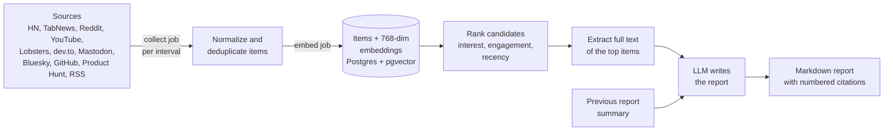
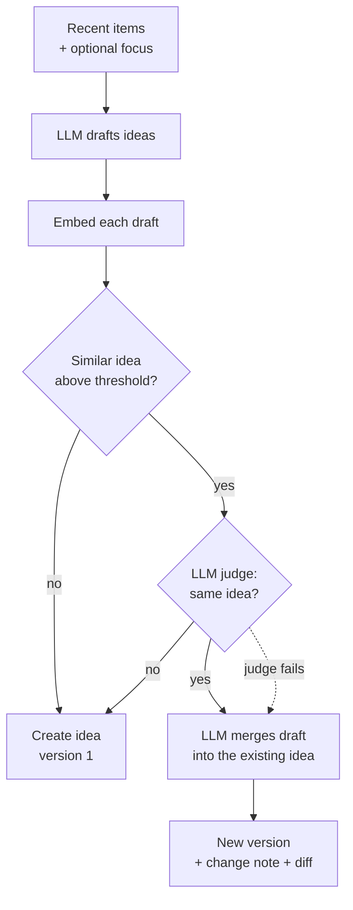

# How it works

newsp has two jobs: turn a stream of public news into a **daily report**, and turn the same
stream into **project ideas** without ever repeating one. Both run in the background worker; the
web app only asks for work and shows the results.

## From sources to a report

1. **Collect.** The scheduler enqueues a *collect* job for every enabled source when it is due.
   The connector fetches the source through an SSRF-safe HTTP client and normalizes each entry
   into an item (title, URL, author, date, metrics such as score and comments). An item is
   unique per source, so re-collecting is harmless. A failing source backs off (up to 6 hours)
   and shows its last error in the admin screen.
2. **Embed.** New items are embedded with the instance embedding model (768 dimensions) and
   stored next to the item. Without an embedding model, collection still works, but ranking
   falls back to engagement and recency.
3. **Rank.** For a report window, newsp picks candidates from enabled sources, balanced per source.
   With embeddings the score is `0.55 × similarity to your interests + 0.30 × engagement + 0.15 × recency`.
   Without them it is `0.70 × engagement + 0.30 × recency`. Sources you excluded in your profile are skipped.
4. **Extract.** Only the selected top items have their full article text extracted, with a short
   timeout, to keep cost and load low.
5. **Write.** The report model receives the items, your interests, your output language and a
   summary of your previous report, and returns Markdown whose claims cite items by number.
   The citations are stored, so each one links back to the original item.

Reports run on schedule (each user's report time and time zone) or on demand for a chosen window.

## From the same stream to ideas

1. **Draft.** The idea model reads recent items and the titles of your existing ideas, and drafts
   ideas with why-now, audience, how, stack, MVP plan, monetization, competitors, difficulty and
   effort, citing the items that support them.
2. **Compare.** Each draft is embedded and compared with your existing ideas, including
   *discarded* ones. If the best match is above the **similarity threshold** (0.80 by default),
   an LLM judge decides whether it is really the same idea.
3. **Merge or create.** If it is the same idea, a merge step writes the next **version** of the
   existing idea, keeps a change note and links the new evidence. If the judge itself fails, the
   draft is merged anyway: a merged near-duplicate is better than a duplicate. Otherwise a new
   idea is created.
4. **Review.** Versions keep their history; the web app shows a diff between versions and the
   news that motivated the change. You can also *deepen* an idea on chosen aspects, or edit it by
   hand, which creates a new version too.

!!! tip "Why discarded ideas still count"
    If you discard an idea and the model proposes it again next week, it would be noise. Discarded
    ideas stay in the dedup index, so the near-duplicate is merged into the discarded one instead
    of reappearing as new.

When an embedding model is not configured, only an exact title match can be detected, so configure
one before generating ideas at scale.

## The job queue

Everything slow runs as a job in a Postgres table, consumed by the worker with
`FOR UPDATE SKIP LOCKED`: collecting, embedding, generating reports and ideas, deepening an idea,
sending e-mails (including password resets), retention and reindexing. The web app polls
`GET /api/v1/jobs/{id}` to show progress. Jobs are retried, stale locks are reclaimed, and finished
jobs are deleted after 7 days. See the [architecture](architecture.md) page for details.
